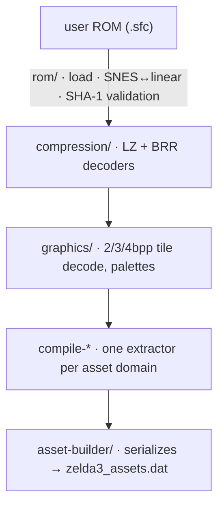

<!-- @layer docs @kind doc -->
# Asset-Extraction Pipeline

The app ships no game data. On first run it reads the user's ROM and produces the
`zelda3_assets.dat` blob the game core loads. That extraction is a pure-TypeScript port of
upstream's Python tools, and it lives in `shared/asset-extraction/`.

## Flow

Public surface is the barrel `packages/asset-extraction/src/index.ts`.

## Layout

| Path | Role |
|------|------|
| `rom/` | ROM loading; **SNES address → linear** conversion (`snesToLinear`). |
| `compression/` | LZ decompression, BRR audio. |
| `graphics/` | Tile/bitplane decode, palette assembly. |
| `text/` · `music/` · `data/` · `dungeon/` · `item-sprites/` · `title-screen/` · `story-intro/` | Domain helpers. |
| `compile-*` | One per domain. A small domain is one file (`compile-dialogue.ts`, `compile-sound.ts`); a large one is a folder of `build-*` steps behind an `index.ts`: `compile-graphics/`, `compile-dungeons/` (rooms, entrances, map, sprites, secrets), `compile-overworld/` (tables, exits, sprites, travel), and `compile-resources-gba-alttp/` for the second cartridge's supplement. `compile-resources.ts` runs the steps into one builder; `compile-alttp-asset-set.ts` adds the optional sources around it. |
| `asset-builder/` | Serializes everything into the `.dat` (`asset-builder.ts`). |

## Rules

- Match the granularity: one `compile-*` file or folder per asset domain. Add a new one instead of bolting onto an existing one.
- Addresses are SNES addresses. Always convert with `snesToLinear` before indexing a linear
  buffer, and don't hardcode linear offsets.
- Validate the ROM against `ZELDA3_SHA1` / `ZELDA3_SHA1_US` so the wrong ROM fails loudly.
- Tests live in `tests/asset-extraction/`. Run only the relevant file
  (`npx vitest run tests/asset-extraction/<file>`).

## Where it runs

Extraction is driven from the Electron main process when a profile/ROM is imported (see
[Data Manager](../user-guide/data-manager.md) and [Importing a ROM](../getting-started/importing-a-rom.md)).
Because `shared/` is the leaf zone, the extractor stays pure and testable, with no Electron or DOM
dependencies (see the [architecture invariants](overview.md)).
