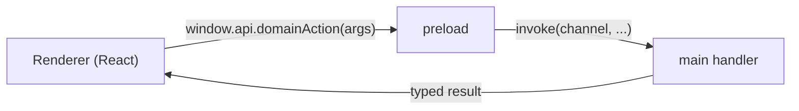

<!-- @layer docs @kind doc -->
# Electron & IPC

The Electron main process owns everything the renderer can't: the filesystem, native modules
(HID/USB), windows, protocols, and all ROM/profile/save I/O. The renderer reaches it only through
IPC, never by importing main-process code (an [architecture invariant](overview.md)).

## The boundary

Every channel's signature lives once, in a channel-keyed contract under
`apps/desktop/src/ipc/`. The preload, the main-process handlers, and the renderer's
`window.api` are all type-checked against it, so a wrong channel name, argument,
or return type is a compile error in any of the three. The IPC machinery itself
(channel maps, typed wrappers, the preload bridge) comes from Brock
(`@drizztdourden08/brock-core` and `@drizztdourden08/brock-electron`); the app supplies
only its own channels.

- Contracts (`apps/desktop/src/ipc/`) are the single source of truth, split by direction:
  `InvokeContract` (request and response, `invoke`/`handle`), `SendContract`
  (fire-and-forget from renderer to main, `send`/`on`), and `EventContract` (main to
  renderer, `emit`/`subscribe`). `contract.type.ts` adds the app's channels to Brock's
  contract interfaces. The invoke side joins one contract per domain
  (`invoke-contract.type.ts`, `apps/desktop/src/ipc/invoke/`, and the `<domain>-contract`
  files beside it).
- `APP_CHANNELS` (`apps/desktop/src/ipc/contract.constants.ts`, built with Brock's
  `defineChannels`) is the only table linking a friendly `window.api` method name to its
  channel; `APP_INVOKE_MAP`, `APP_SEND_MAP` and `APP_EVENT_MAP` are its three halves.
  `RotpNamespaces` (the `window.api` type, in `apps/desktop/src/ipc/namespaces.type.ts`) is
  derived from these maps with Brock's `ChannelApi`, so a method's signature is never
  hand-written twice. Renderer code calls `window.api` directly.
- Typed wrappers cover both sides. Main uses `handle`/`emit` from
  `@drizztdourden08/brock-electron/main`; the preload (`apps/desktop/electron/preload.ts`)
  calls `createPreloadBridge` from `@drizztdourden08/brock-electron/preload` with the composed
  maps. App code never touches raw `ipcMain`/`ipcRenderer`/`webContents.send`.
- The preload's flat methods are generated from the maps; nested namespaces
  (`shadowCasting`, `screenEditor`) are wired explicitly in
  `apps/desktop/electron/preload-namespaces/`.
- Each domain exports a `HandlerGroup` from `apps/desktop/electron/handlers/<domain>-handlers.ts`,
  whose `register` calls the domain's `register*()` functions. `brock sync` collects every
  group into the generated `apps/desktop/.brock/handlers.main.ts`, and groups in a `*.dev.ts`
  file load in development only.
- To add a channel, see [Adding an IPC Channel](../contributing/adding-an-ipc-channel.md)
  or the `electron` skill.

## Domains (`apps/desktop/electron/`)

| Domain | Responsibility |
|--------|----------------|
| `assets/` | Check / load / extract `zelda3_assets.dat`. |
| `sprites/` | Per-ROM sprite extraction + the sprite-debug store. |
| `languages/` | Translation extraction + dialogue. |
| `msu/` | MSU-1 pack import, listing, track files. |
| `input/` | Only the WebHID and WebUSB device permission choosers. Controller IPC (state, devices, calibration, rumble, raw capture, debug files) lives in the Brock `input` module, not in this folder. |
| `connections/` · `screen-editor/` | Navigation connection/nav review + (dev) screen editing. |
| `shadow-casting/` | Per-screen heightmap + lighting data. |
| `hub/` · `sanctuary/` · `store/` | Hub sign-in, bug reports, and the community store. |
| `recommendations/` · `documents/` · `diagnostics/` | Data-inspector recommendations, documents, debug reports. |
| `tools/` | External tools such as ffmpeg. |
| `protocol/` | The app's own custom protocols (e.g. `app-debug-capture://`). |
| `debug/` · `automation/` | `--dump-layers`/`--dump-nav` exporters and `--auto-state`/`--screenshot` test hooks. |

Shared domains come from Brock and do not live in this folder. Profiles, sessions, native
dialogs, windows, storage and the `app-sprite://` scheme are part of
`@drizztdourden08/brock-electron`; ROM identification and save states are in the `port-kit`
module; auto-update is the `updater` module. `apps/desktop/brock.config.ts` lists the modules
the app uses.

## Native modules

The SDL3 controller addon lives only in the main process, never in a package or the renderer.
It ships with Brock's `input` module. Controller input is read in main and forwarded to the
renderer already decoded, via that module's `input:*` channels. The module also owns the Controllers screens and the channels behind them, so the app registers no controller channels of its own. See [Input & Controllers](../user-guide/input-controllers.md) and
[Haptics](../user-guide/haptics.md).

## CLI / automation flags

The main process parses argv for automation: `--no-focus`, `--muted`, `--auto-state=N`,
`--screenshot=NAME`, `--dump-layers=N` (+`--hover-tile=col,row`), `--dump-nav=N`, `--auto-flood`.
See [Testing](../contributing/testing.md) and [Developer Tools](../user-guide/developer-tools.md).
