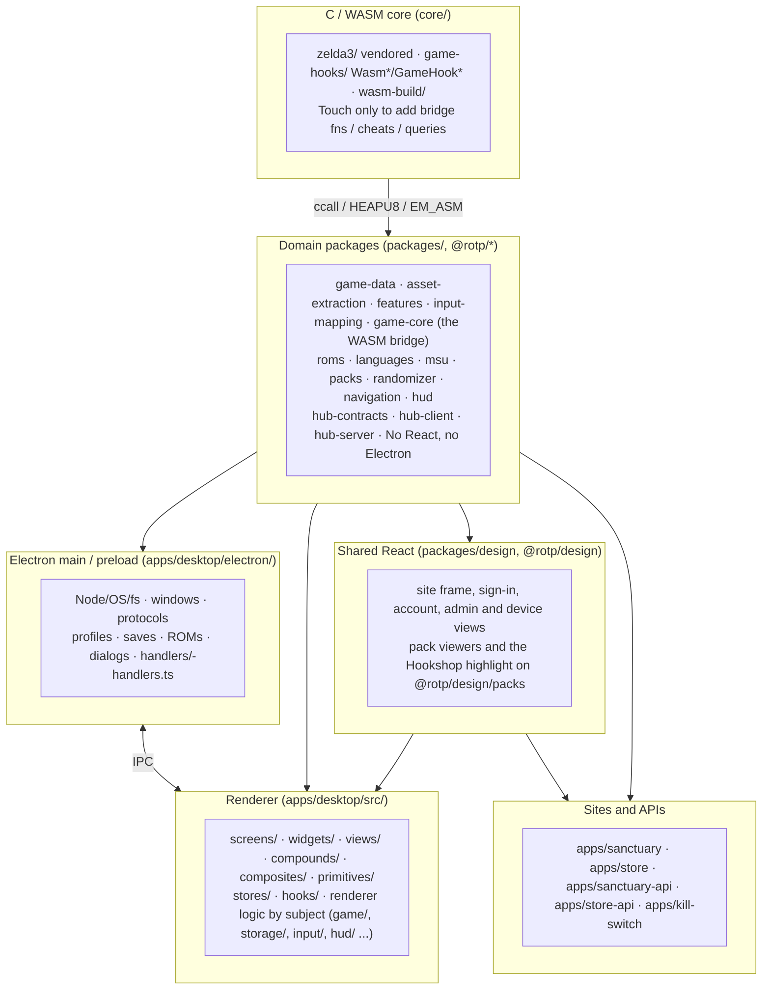

<!-- @layer docs @kind doc -->
# Architecture Zones, Boundaries & Where Code Goes

The map for keeping this project structured: the zones, the dependency invariants
that must hold, and a placement guide for new code. Every feature is analyzed against
this before code is written (see the `architecture` skill).

Companion docs: @docs/contributing/design-system.md (UI tiers), @docs/contributing/coding-standards.md (file
rules), and the `refactoring-guru` skill (patterns/smells). Build/bridge specifics:
the `electron`, `add-wasm-function`, `build-wasm` skills.

## Zones

Packages are imported by name, through their barrel (`@rotp/<subject>`) or one of the
few subpaths a package exports (`@rotp/asset-extraction/buffer`, `@rotp/asset-extraction/node`, `@rotp/hub-contracts/node`,
`@rotp/design/packs`). Inside the desktop app, `@app/*` points at `apps/desktop/src/`.

## Dependency invariants

1. Apps depend on packages, packages on lower packages, and nothing depends on an app.
   The package order is asset-extraction, game-data, hub-contracts, features,
   input-mapping, game-core, roms, languages, msu, packs, randomizer, navigation, hud,
   hub-server, hub-client, design.
2. Domain packages hold no React and no Electron. React that two apps share lives in
   `packages/design`; React that one app uses stays in that app.
3. Code that only runs in Node sits behind a package's `./node` subpath, so a renderer
   or a site never loads it through the barrel.
4. The renderer (`@app/*`) may import packages, Tessera and `window.api`. It cannot import
   from `apps/desktop/electron/*`; cross that boundary only through IPC.
5. Electron (`apps/desktop/electron/*`) may import packages. It cannot import renderer
   code (`@app/*`) or React.
6. The WASM module is reached only through `@rotp/game-core`, the bridge Facade, and the
   renderer glue in `apps/desktop/src/game/`. No raw `ccall`/`HEAPU8` lives outside them.
7. Bare UI tiers (primitive/composite/compound) cannot import stores, `window.api`, the
   game bridge, or navigation. Data flows in via props, and Views do the wiring. See
   @docs/contributing/design-system.md.
8. `core/` C is edited only per the bridge rules (`add-wasm-function`).
9. The dataset has one door: the facade in `packages/game-data/src/data` (`all`, `find`,
   `get*`), re-exported by `@rotp/game-data`. No code outside `packages/game-data/src/data/`
   imports a record file, a collection loader or the registry; an ESLint
   `no-restricted-imports` rule refuses it inside the package and the package boundary
   refuses it everywhere else.

If a change would break an invariant, the code is in the wrong zone. Re-place it.

## Placement guide for "I'm adding X, where does it go?"

| The new code | Goes in | Notes |
|----------------|---------|-------|
| Needs Node/OS/fs/native, windows, ROM/profile/save IO | `apps/desktop/electron/<subject>/` behind a handler in `apps/desktop/electron/handlers/` | Add the channel to the `apps/desktop/src/ipc/` contract. Use the `electron` skill. |
| Talks to the running game / WASM | `packages/game-core/src/` | A new C function follows `add-wasm-function` (C + bridge; `EMSCRIPTEN_KEEPALIVE` auto-exports, so there is no export list). Glue that reads a renderer store stays in `apps/desktop/src/game/`. |
| Pure game rule, algorithm or record | `packages/game-data/` (data, logic, events, seed) | Must stay pure and testable. |
| Pathfinding, flood, simulator, tracker | `packages/navigation/` | |
| Randomizer world or the room client | `packages/randomizer/` | |
| Parses a ROM / builds assets | `packages/asset-extraction/src/` | One `compile-*` per domain; Node readers on `./node`. |
| Contract read by the desktop app, a site and an API | `packages/hub-contracts/` | Types, schemas, rights, routes. |
| Generic UI atom (Button, Select) | Tessera `@drizztdourden08/tessera/primitives` | use the part; a missing one is a Tessera proposal |
| Generic structural combo (Card, Dialog, Overlay) | Tessera `@drizztdourden08/tessera/composites` | use the part; a missing one is a Tessera proposal |
| Domain-specific presentational card/form (ProfileCard, SaveSlot) | `apps/desktop/src/compounds/` | takes a domain prop, fetches nothing |
| Feature/page with logic + data | `apps/desktop/src/views/` | owns stores/IPC/game; logic in `behavior/` |
| A part a site and the desktop app both draw | `packages/design/src/` | compounds and views, the packs viewers under `packs/` |
| A view that draws game state the way the game draws it | compose the HUD compounds (`compounds/Hud*`, `compounds/Pause*`, `compounds/Dialog*`) | the HUD compounds are presentational, so a widget may lay hit zones over them (the cheat console does) |
| Renderer UI state | `apps/desktop/src/stores/` | Zustand |
| Shared renderer hook | `apps/desktop/src/hooks/` | non-feature-specific |
| Renderer logic with no React | `apps/desktop/src/<subject>/` | named for its subject, never `lib` or `utils` |

## The rule: analyze before building

Before writing a feature, run the architecture analysis (the `architecture` skill):

1. Decompose the feature into pieces: UI, state, domain logic, data/IO, bridge, C.
2. Place each piece via the guide above.
3. Verify the dependency invariants hold for every placement.
4. Run a pattern pass (`refactoring-guru`) and name the pattern(s) each piece uses.
5. Emit the plan per @docs/contributing/plan-format.md, with a CRUD filetree, the data model in TS, and the flow.

No feature work starts without this analysis and a plan.
