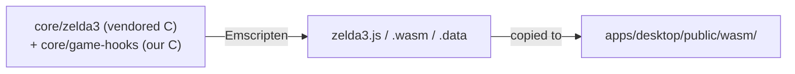

<!-- @layer docs @kind doc -->
# The WASM Bridge

The bridge is the seam where TypeScript talks to the compiled C game core, and it's
the hardest part of the codebase to reason about. This page is the mental model; the
full function list is the [Game Hooks Reference](../hooks/overview.md).

## What gets built



`core/game-hooks/` is our layer. Every `Wasm*` export and `GameHook_*` callback lives here, or in
`core/wasm-build/emscripten_*.c`. `core/zelda3/` is vendored: touch it only to insert a hook
call-site at a gameplay event. The built module is not committed: `pnpm run dev` and
`pnpm run build` run `ensure-wasm` first, which rebuilds it when it is missing or older than any
C source, so a C change needs the Emscripten SDK (see [Building WASM](../contributing/building-wasm.md)).

## The two directions

| Direction | Mechanism | Where |
|-----------|-----------|-------|
| JS to C | `mod.ccall('Wasm...', ret, argTypes, args)` | wrappers in `packages/game-core/src/bridge/` |
| C to JS | `EM_ASM(window.__on...(...))` | C in `game-hooks/`, handlers in the renderer |

The bridge is a Facade: raw `ccall`/`HEAPU8` access lives in the game layers
(`packages/game-core/src/` and the app's `apps/desktop/src/game/`), and views, widgets and
stores reach the game through them, an [architecture invariant](overview.md).

```
packages/game-core/src/
├── wasm-bridge/          singleton module ref, game state, input
├── bridge/               grouped ccall facades (commands, render, ui-state,
│                         progress, room-grids, room-layout, room-doors,
│                         sprites-blockers, nav-tables, ...)
├── bridge/wasm-call/     typed call helpers (number, void, pointer, table decoders)
├── cheats/  live-settings/  save-state/  sram-sync/  auto-save/  fps.ts
├── haptic-polling/  ui-bridge/  ui-bridge-parser/  (parsers for the state buffers)
```

## Returning data across the boundary

C can't return a struct, so a query writes into a static buffer and returns its address; JS reads the
bytes from the heap (little-endian, parse immediately):

```ts
const ptr  = mod.ccall('WasmGetInventoryState', 'number', [], []);
const bytes = mod.HEAPU8.subarray(ptr, ptr + 40);
```

The parsers in `packages/game-core/src/ui-bridge-parser/` and the tracker reads in
`packages/navigation/src/tracker/` turn those buffers into typed objects. Each buffer's layout
is documented per-function in the [hooks reference](../hooks/overview.md).

## The 2-place rule

Adding a boundary function touches two places:

1. The C impl in `core/game-hooks/*.c`, tagged `EMSCRIPTEN_KEEPALIVE`. That
   attribute both retains and exports the symbol, so there is no
   `EXPORTED_FUNCTIONS` list to edit, and none to keep in sync between `build.bat`
   and `Makefile`.
2. The JS `ccall` wrapper in `packages/game-core/src/bridge/`.

Then rebuild WASM. Forget the `KEEPALIVE` tag and the symbol won't be callable; skip the rebuild and C
edits don't take effect. Full procedure: [Adding a WASM Function](../contributing/adding-a-wasm-function.md).
